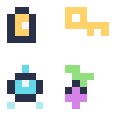

# Pixel Sprite Atlas 🎨🎮

Dibuja pequeños sprites con caracteres y conviértelos en un **atlas PNG RGBA**, un índice JSON y una vista SVG ampliada. Útil para crear iconos originales de inventario, prototipos y game jams sin un editor de imágenes ni servicios externos.

Creado el **30 de octubre de 2026**. Python **3.10+**, solo biblioteca estándar; sin instalación de paquetes, API ni claves. El código y los cuatro diseños de ejemplo son originales y se distribuyen con licencia MIT.



La imagen conserva transparencia. En el ejemplo aparecen una linterna, una llave, un dron y una semilla. El atlas mide 16 × 16 píxeles; la vista SVG se muestra ampliada 8 veces.

## Instalación y ejecución

```bash
git clone https://github.com/alvaroalcalaa/pixel-sprite-atlas.git
cd pixel-sprite-atlas
python atlas.py examples/sprites.json --columns 2 --padding 1
python -m unittest -v
```

El primer comando escribe tres archivos en `build/`:

| Archivo | Contenido |
|---|---|
| `atlas.png` | Imagen RGBA de 8 bits por canal, sin pérdida, a tamaño nativo |
| `atlas.json` | Rectángulos de recorte y tamaño/posición de cada sprite original |
| `preview.svg` | Vista ampliada con píxeles definidos y transparencia, sin recursos externos |

Usa `--out-dir otra-carpeta` para cambiar la salida. Los tres archivos se reemplazan si existen. Se impide sobrescribir el archivo de entrada. Código de salida **0** al generar correctamente y **2** ante argumentos, datos o escritura incorrectos. Un fallo de escritura puede dejar una salida parcial; no hay transacción de varios archivos.

## Crear tus propios sprites

```json
{
  "palette": {"X": "#FFD369FF", "s": "#63D8E880"},
  "sprites": [
    {"name": "spark", "rows": [".....", "..X..", ".XsX.", "..X..", "....."]}
  ]
}
```

Cada carácter es un píxel. `.` está reservado para transparencia completa. Los colores usan siempre `#RRGGBBAA`: `FF` es opaco, `00` transparente y `80` aproximadamente un 50 % de opacidad. Los símbolos de paleta deben ser un solo carácter y no pueden ser `.`.

Las filas de un sprite deben tener la misma anchura. Los nombres, únicos, admiten letras ASCII, números, guion y guion bajo. El orden del atlas sigue el orden de `sprites` en el JSON.

## Recorte y coordenadas

Se recorta el rectángulo mínimo que contiene todos los píxeles con alfa mayor que cero. Los píxeles semitransparentes se conservan. Los completamente transparentes se normalizan a RGBA `(0,0,0,0)`, aunque su color RGB de entrada fuera distinto. Un sprite totalmente transparente se rechaza para evitar rectángulos vacíos.

Los sprites recortados se colocan en una cuadrícula de celdas del tamaño del sprite recortado más ancho/alto, con margen transparente por cada lado. No se rotan. Las columnas se reducen al número de sprites si se solicitan más de las necesarias. La cuadrícula es determinista y sencilla; no busca el empaquetado de menor superficie.

Cada entrada de `frames` en `atlas.json` contiene:

| Campo | Uso |
|---|---|
| `frame` | Rectángulo `(x,y,w,h)` para extraer píxeles del PNG |
| `sourceSize` | Anchura y altura antes del recorte |
| `spriteSourceSize` | Posición `(x,y)` del recorte en el original y tamaño recortado |
| `trimmed` | Si el tamaño original se redujo |
| `rotated` | Siempre `false` |

Todas las coordenadas se miden en píxeles, con origen arriba a la izquierda. Para reconstruir un sprite, crea una imagen transparente de `sourceSize`, extrae `frame` del atlas y pégalo en `(spriteSourceSize.x, spriteSourceSize.y)`. Para dibujarlo manteniendo el origen original, añade ese desplazamiento a la posición de destino. El formato se identifica como `pixel-sprite-atlas-v1`; **no es un exportador compatible garantizado con TexturePacker u otro formato externo**.

## Límites reales

Entrada UTF-8 de hasta 1 MiB, entre 1 y 64 sprites, cada uno de hasta 64 × 64 píxeles. `--columns` admite de 1 a 16; `--padding`, de 0 a 8. Se rechazan claves JSON duplicadas, símbolos desconocidos, filas irregulares y nombres duplicados. Otros campos de entrada se ignoran.

No importa PNG existentes, no dibuja mediante IA, no genera animaciones y no añade extrusión de bordes ni mipmaps. El padding transparente por sí solo no garantiza evitar artefactos con filtrado lineal o mipmaps; adapta el muestreo a tu motor y comprueba el resultado. La vista SVG usa una precisión de seis decimales para la opacidad; el PNG conserva los valores alfa originales de 8 bits.

No hay integración probada con Unity, Godot, Unreal ni un framework de juego. Las pruebas son locales: recorte y desplazamientos, ausencia de solapamiento, transparencias, límites, ejecución CLI y estructura PNG (CRC, cabecera y reconstrucción exacta de los bytes de imagen). La demo publicada se generó con el mismo código; su PNG se obtiene ejecutando el comando de arriba.

## Dependencias y licencia

Solo Python: `argparse`, `json`, `struct`, `zlib` y otros módulos estándar. No se envían datos por red. Consulta `LICENSE` (MIT).
